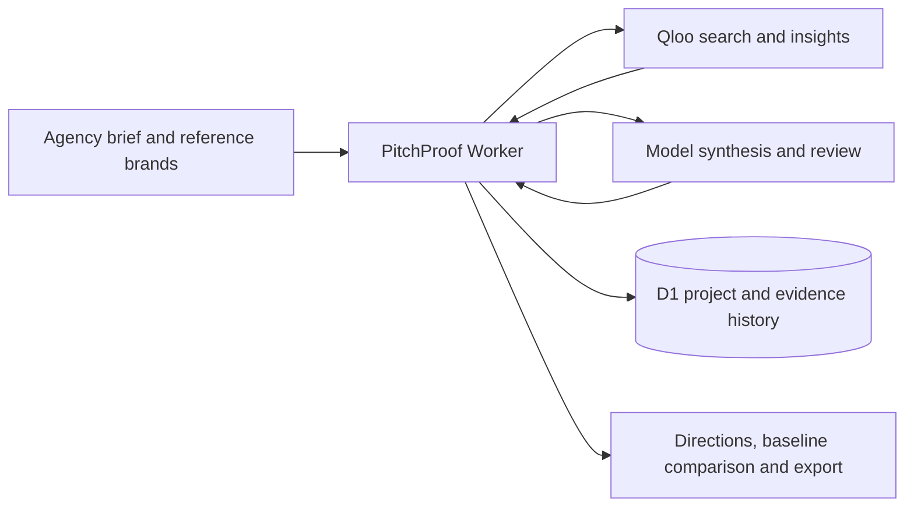

# PitchProof

Turn a client brief into campaign directions with evidence behind each and a plan to test them.

PitchProof is a campaign-research application for independent creative agencies. It uses Qloo to investigate cultural connections across brands, music, film, places, and podcasts. A model turns the resulting observations into creative proposals. Source observations, generated hypotheses, and agency annotations remain separate.



Open the [published app](https://pitchproof-studio.zippy17.chatgpt.site). The [public source repository](https://github.com/VasuBansal7576/pitchproof-qloo-2026) includes the MIT license and setup instructions. The [judge instructions](docs/submission/judge-testing.md) and [readiness review](docs/submission/readiness-review.md) distinguish live failures from historical successful samples. A test or build pass does not mean the current hosted creative flow has passed.

The broader goal covers lifestyle agency campaigns. Footwear is the first acceptance case. The [founder briefing](docs/submission/founder-pitch.md), [conditional economics](docs/submission/unit-economics.md), and [agency worksheet](docs/agency-review/review-worksheet.md) state the unverified business assumptions.

## Run locally

Use Node.js 22.13 or newer.

1. Run `npm ci`.
2. Copy `.env.example` to `.dev.vars`.
3. Add a Qloo hackathon key and a model API key to `.dev.vars`.
4. Run `npm run build` to create the local Worker configuration.
5. Apply the SQL files in `drizzle/` in filename order with the command below.
6. Run `npm run dev` and open the local URL printed by the server.

Apply each pending migration once. Replace the filename with the pending migration.

```sh
node --import ./scripts/sites-env.mjs ./node_modules/wrangler/bin/wrangler.js d1 execute DB --local --config dist/server/wrangler.json --persist-to .wrangler/state --file drizzle/0000_messy_venom.sql
```

Local and hosted databases are separate. Do not add credentials or Qloo response data to the repository.

## Configure providers

| Variable | Purpose |
| --- | --- |
| `QLOO_API_KEY` | Qloo hackathon credential for `https://hackathon.api.qloo.com`. |
| `DEMO_UNLIMITED_DAILY_CAP` | Set to `true` to bypass the owner and site daily request caps for a demo. Usage reservations and accounting remain active. The default is `false`. |
| `MODEL_API_KEY` | Server credential for Gemini or OpenAI. Also used as a fallback for OpenCode when `OPENCODE_API_KEY` is empty. |
| `OPENCODE_API_KEY` | Server credential for OpenCode Go. |
| `MODEL_PROVIDER` | `opencode`, `gemini`, or `openai`. The default is `gemini`. |
| `MODEL_NAME` | Model identifier. Defaults to `gpt-6-luna` for OpenCode Go, `gemini-2.5-flash` for Gemini, or `gpt-4.1-mini` for OpenAI. |

Gemini 3.x configurations use stateless Interactions requests. Gemini 2.5 configurations retain the legacy generateContent transport. The workspace settings show the deployed model; it is a runtime setting independent of source releases. Set `MODEL_NAME` explicitly for the model enabled on your provider account.

Successful Qloo responses are cached in each worker instance for up to 15 minutes, keyed by the full request URL and credential. The cache holds at most 50 responses of 100 KB each, is not shared across instances, and does not cache failures. Usage accounting counts reservations even when a response is served from cache.

For OpenCode Go, set `MODEL_PROVIDER=opencode` and provide its API key as the server-side `OPENCODE_API_KEY` secret. An absent or empty `OPENCODE_API_KEY` falls back to `MODEL_API_KEY` for existing local setups. Keep the Gemini key in `MODEL_API_KEY` for rollback. Requests go to the fixed OpenCode Go endpoint. The hosted Worker cannot use a local Codex CLI subscription as a fallback. A transient generation or review failure gets one quota-reserved retry; invalid generated drafts get one quota-reserved repair attempt. Live provider compatibility must be verified with the configured account before relying on it.

The app reports missing provider configuration and retains your draft. It does not substitute sample evidence or generated campaigns. Qloo keys may require manual approval. Model availability, quotas, and billing belong to the configured provider account.

## Create a campaign brief

1. Enter the product, market, intended audience and objective. Add one to eight explicit supplied product facts, separately from unverified brief context. An optional shared CTA defaults to Explore followed by the product name.
2. Enter three reference brands. Label each as a competitor, aesthetic reference, or audience proxy.
3. Search Qloo and confirm the exact brand entities. Open Reference brands and use Change match to correct a confirmed identity.
4. Start research. Keep the app open while it advances the research steps. Reopen the project to resume interrupted work.
5. Compare the generated directions, inspect their linked evidence, and view the actual reference images supplied through Qloo. Missing or blocked images have a labelled fallback.
6. Select a direction or give feedback for a revision. Revisions perform further research.
7. Add agency annotations to evidence or directions. Open Run performance & operator review to record acceptance of the selected current proposal for further planning. Later edits invalidate that acceptance. Export a Markdown brief or printable HTML brief. Use your browser's Print command to save the HTML as a PDF. Markdown exports also open a plain-text preview with a copy option for browsers that block file downloads.

The sample input button fills a brief. It does not create research results.

New generations include a campaign proposition, audience tension, product role, mechanism, specific ad execution, and call to action. Each interpretation links to its exact saved observation. The three campaign devices cover participation, a human story, and product discovery. Existing historical briefs retain their original format.

Revisions include the selected parent, its agency notes, notes on its cited evidence, earlier feedback, and the latest rejection reasons. A separate automated model check looks for unsupported product claims in all three proposals before they enter history. It does not verify evidence, assets, rights, campaign quality or test design. A validated draft is stored in a private table while review runs. An unchanged-context review transport failure retries the review without generating another draft. If the reviewer finds an unsupported product claim, the service attempts one repair. A direction with a remaining unsupported claim is labeled for review and omitted from export. Known-pattern claim violations can still stop generation after repair. Changed context requires fresh synthesis. A saved draft can be reused for 24 hours and active retries renew that window. Expired rows are pruned in bounded batches during provider admission. This check can miss defects and does not replace agency review.

Pilot plans use visible PitchProof planning defaults. The model supplies one short declarative campaign message. The server compares it with a neutral product introduction and fixes the shared asset plan, soundtrack, facts, duration, audience, channel, CTA and landing page. Only the message changes. These are planned production controls, not existing or licensed assets. The server also supplies a proposed spend cap and duration, a delivery floor, CTR definition, and an inconclusive outcome. Before launch, the agency must approve the actual spend and calculate sample requirements from its baseline and decision threshold. No advertising spend occurs inside PitchProof. An association or a small pilot does not prove purchases.

Run measurements record research, generation and review requests, including failed attempts. They exclude reference lookup and model-based revision planning. Request durations can overlap and are not a wall-clock total. Automated readiness and explicit operator acceptance have separate elapsed times. Historical missing values remain unknown. If a long run exceeds 80 retained events, the UI and export label those counts as partial. No external agency acceptance or campaign outcome is inferred.

## Interpret the evidence

Qloo describes aggregate associations. Reference brands do not prove who a client's actual customers are. Aesthetic references and competitor brands remain hypotheses about campaign relevance.

Scores retain their original metric and query context. Compare results within the same query. Scores are not purchase probabilities or calibrated confidence estimates. Geographic filtering applies only where the selected Qloo category supports it. The evidence view and export disclose that distinction.

The generation evidence view includes all collected records, including records not cited by a direction. Each direction links its own citations. Exported briefs include evidence supporting the exported directions.

Reference imagery uses Qloo entity URLs. Images and source links may depend on external hosting. Confirmed references are frozen with each new generation so later brief edits do not change its board. Earlier generations without stored entity snapshots retain their original reference names.

Campaign hooks, visual treatments, channel suggestions, and test thresholds are proposals. Referencing an artist or film does not grant permission to use its name, imagery, music, or likeness in advertising.

## Verify a change

Run `npm test`, `npm run typecheck`, and `npm run build`. Backend tests use synthetic provider fixtures and local D1. A test pass does not establish live provider access. Test a real research and revision flow after configuring production credentials.

Run a configuration preflight without creating projects or requesting provider data:

```sh
node scripts/verify-live-flow.mjs
```

Use `--storage-only` to create one labelled private guest draft and verify persistence, owner isolation, command replay, version conflicts and export readiness without provider calls. Use `--run` to create a new private QA campaign and spend real Qloo and model requests on research, directions, feedback-led revision and exports. The default target is this installation's public Site. An explicit `--base-url` may point only to loopback or that exact public origin. Each run saves a receipt under ignored `outputs/live-flow/`. A blocked preflight exits2. Check the receipt status because a preflight or storage pass does not establish a real workflow pass. The guest session remains in memory and is discarded at exit. Semantic evidence review, reference sensitivity, the browser journey and print layout remain separate checks.

To verify model compatibility independently of Qloo, configure the provider credential, `MODEL_PROVIDER` and `MODEL_NAME` in the process environment, then run:

```sh
node --import tsx scripts/verify-live-model.ts
```

This opt-in check makes five real model requests, including two automated campaign reviews with explicitly invented evidence. It verifies structured synthesis, feedback planning, revision citation IDs, preserved history and export rendering. All artifacts under ignored `outputs/pre-qloo-model/` are labelled synthetic. They must never be presented as actual Qloo results or client research. Provider credentials must remain outside source and command arguments.

## Deploy with Sites

This repository uses Vinext, React, and Cloudflare D1. The Sites integration in `vite.config.ts` emits the Worker artifact and preserves hosted identity.

The `.openai/hosting.json` file binds the database as `DB`. Its `project_id` identifies this installation. To create a separate installation, use the Sites creation workflow and replace that ID with the returned project ID. Configure provider credentials with the Sites runtime-secret tools. Do not put secrets in the hosting manifest.

Sites applies tracked Drizzle migrations during deployment. The local `dist/` directory is generated output. Publish a verified source commit and its matching build artifact.

## Source map

| Path | Responsibility |
| --- | --- |
| `components/pitchproof/` | Agency workspace, briefs, direction comparison, and evidence inspection. |
| `lib/pitchproof-types.ts` | Shared project, evidence, direction, and command types. |
| `server/` | Owner isolation, durable project operations, provider calls, and validation. |
| `app/api/` | HTTP endpoints and authorized exports. |
| `db/schema.ts` and `drizzle/` | Database schema and migrations. |
| `lib/export.ts` | Escaped HTML and Markdown brief rendering. |
| `tests/` | Behavioral tests with synthetic data. |

## License and commercial use

The application code is MIT-licensed. Qloo data, API access, model services, and third-party assets retain their own terms. The code license does not grant Qloo commercial rights. Confirm production pricing, paid access, retention, and client export rights with Qloo before selling briefs or operating a paid service.
